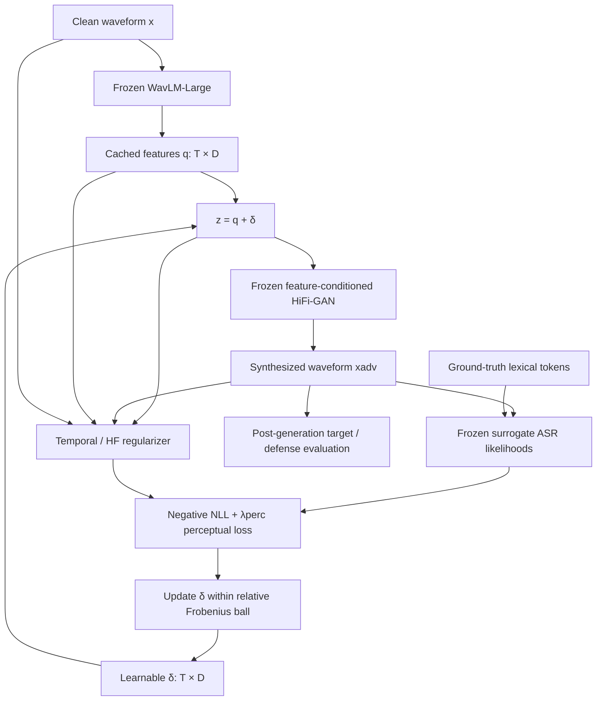

# Beyond Waveform: implementation and reproduction specification

Source of record: the supplied 11-page PDF, *Beyond Waveform Robustness: Robust Feature-Vocoder Adversarial Attacks on Automatic Speech Recognition*, arXiv:2606.05678v1, dated 4 June 2026. Locations below refer to its printed page numbers. All Sections 1–15 below analyze this version, including Appendices A–D and Tables 2–4 on pages 10–11. No implementation code is included.

Evidence labels:

- **EXPLICIT**: directly stated in this paper; not necessarily sufficient to implement.
- **INFERRED**: a strong implication or mathematical consequence, identified as such.
- **UNSPECIFIED**: not established by this paper. A named upstream model does not establish its checkpoint, configuration, or the authors' usage.
- **PROPOSED**: a reproduction-engineering test or experiment, not an author specification.
- **PLOT APPROXIMATION**: visual estimate, never an exact reported measurement.

**Feasibility assessment.** The mathematical attack can be reconstructed, but exact numerical reproduction is not currently identifiable from the paper alone. The largest blockers are a compatible WavLM-to-HiFi-GAN model and its weights; attack update/initialization rules; dataset manifests and validation split; Mandarin fine-tuning; and undefined defense implementations/checkpoints. A documented independent implementation is feasible after these choices are made, but should not be represented as an exact recreation of the authors' implementation.

External-artifact check: a title/identifier search found the matching arXiv record and secondary listings, but did not establish a usable official code or separate supplement. Direct retrieval of the arXiv landing page failed in this environment. This is not proof that no supplement exists. No external implementation details are imported as if they were paper facts. Before implementation, request the artifacts listed in Section 10 from the authors or verify them from primary upstream sources.

## 1. Paper overview

| Item | Extraction and evidence |
|---|---|
| Title | Beyond Waveform Robustness: Robust Feature-Vocoder Adversarial Attacks on Automatic Speech Recognition (p.1). |
| Authors | Yifan Liao; Zongmin Zhang; Zhen Sun; Yuhui Sun; Xinhu Zheng; Xinlei He. Xinlei He is corresponding author (p.1). |
| Year / venue | 2026; supplied version is arXiv:2606.05678v1 [cs.SD], 4 June 2026. A conference/journal venue is **UNSPECIFIED**. |
| Problem | Generate speech that causes transcription errors on unseen ASR systems and defended models while retaining original perceived speech content and quality. |
| Contribution | A per-utterance, clean-referenced feature-vocoder attack; representation-space radius constraint; clean-normalized temporal and high-frequency regularization; transfer, defense, quality, human, and OTA evaluations. |
| Proposed method | Frozen WavLM-Large features plus a learnable additive feature tensor; frozen HiFi-GAN waveform reconstruction; maximize ground-truth transcript NLL on a Whisper-small surrogate while minimizing perceptual penalties. |
| Attack baselines | PGD; MI-FGSM; VMI-FGSM; Muting Whisper; SlothSpeech, abbreviated Sloth in Table 1. |
| Datasets | LibriSpeech (English) and AISHELL-1 (Mandarin). Section 5 names train-clean-100, but Appendix D identifies a 999-utterance test-clean subset for attack evaluation. |
| Surrogates | Raw Whisper-small for English; Whisper-small fine-tuned on AISHELL-1 development data for Mandarin. |
| Targets | Raw/defended Whisper-small; Whisper-tiny, base, medium, large in Figure 3; Wav2Vec2 CTC and HuBERT CTC in Figure 4. Exact checkpoint IDs are absent. |
| Defenses | CE-AT, DT-AT (called DE-AT in prose), DMW, TI; LPF, WaveGuard, AudioPure, PVP Vote. Definitions/configurations are mostly absent. |
| Principal claims | Average transfer gain +26.6 WER; average adversarial-training-defense gains +36.2 WER English and +31.3 CER Mandarin; high automatic quality, human intelligibility, and OTA effectiveness. Treat the gains as error-rate percentage-point differences, not relative percentages (**INFERRED**). |
| First targets | English clean and reconstruction controls; Table 1 feature row on raw Whisper-small; Table 4 quality; Figures 5–6 and 8; then raw-model transfer. Full defense/baseline grids are conditional on artifact recovery. |

In ordinary terms, the method replaces direct waveform-noise optimization with optimization of a speech representation. For each recording, a frozen encoder produces frame-level features. Only a same-shaped perturbation tensor is updated. A frozen vocoder converts the perturbed features into audio, and a frozen surrogate recognizer supplies a differentiable loss encouraging errors on the correct transcript. Two clean-referenced penalties discourage temporal feature jitter and excess high-frequency waveform energy. The final reconstructed audio is reused on targets without target feedback. This is an **untargeted**, **per-example** attack; it is not a trained universal perturbation generator. The Mandarin surrogate and some defenses require separate model training.

## 2. Reproduction target

Priority is implementation order and feasibility, not a ranking of methods. P1: core result; P2: extension; P3: resource/artifact-dependent.

| Experiment | Paper section/table/figure | Dataset | Metric | Reported result | Reproduction priority |
|---|---|---|---|---|---|
| English raw clean and feature attack | §5, Table 1 p.5; App. D | LibriSpeech; 999 test-clean subset indicated in App. D | WER % | Clean 4.75; feature 75.43 | P1 |
| English attack/defense grid | Table 1 | Same English evaluation pool implied | WER % | Complete grid below | P2; defenses blocked |
| Mandarin raw clean and feature attack | Table 1; §5 | AISHELL-1 held-out test; count absent | CER % | Clean 6.29; feature 72.25 | P2; surrogate fine-tuning blocked |
| Mandarin attack/defense grid | Table 1 | AISHELL-1 test | CER % | Complete grid below | P3 |
| Whisper-family transfer | §5, Figure 3 p.6 | English LibriSpeech implied; exact manifest absent | WER % | Tiny DT-AT 64.90, WaveGuard 54.75; large raw 52.96. Base/medium plotted too | P2 raw; P3 defenses |
| Cross-architecture transfer | §5, Figure 4 p.6 | English implied | WER % | HuBERT raw 39.80, all displayed defenses above 30; Wav2Vec2 raw 42.12, LPF 48.24 | P2 raw; P3 defenses |
| Objective quality across attacks | §5, Table 4 p.11 | Exact quality pool unspecified; English likely | DNSMOS, NISQA, UTMOS | Clean 3.075/3.714/3.755; feature 2.954/3.526/3.590; full table below | P1 feature/control; P2 baselines |
| Perceptual-weight sweep | Figure 5 p.6 | English implied | WER %, three quality scores | λperc = 0.1, 0.5, 1, 2; exact per-point data absent; default WER 75.43 in prose | P1 trends; exact curve unavailable |
| Feature-radius sweep | Figure 6 p.7 | English implied | Same | ρ = 0.05, 0.1, 0.5, 1; exact per-point data absent | P1 trends |
| Loss ablation | §5, Figure 8 p.7 | English implied | WER %, DNSMOS OVRL | Without attack loss 6.6% WER; other values only plotted | P1 with discrepancy flag |
| Representative acoustic visualization | Figure 7 p.7 | One unidentified sample | Mel correlation, pitch overlay | Correlation 0.9733 | P2 qualitative; exact sample blocked |
| Human listening/transcription | §5 p.6 | Two independent 100-sample sets; source unspecified | Indistinguishability, artifact judgments, human WER | 10 volunteers; 86%, 92%, 5.47% | P3; new study is conceptual replication |
| Physical playback/re-recording | §5 p.7, App. B, Table 3 | 100 English utterances, 3 speakers | WER % | Clean OTA 7.45; adversarial OTA 78.23 | P3; original hardware/audio absent |
| Timing | App. D p.10 | 999 LibriSpeech test-clean utterances | Seconds, GPU-hours | ~10 s/utterance; ~2.8 GPU-h generation, ~4 GPU-h including loading/I/O/evaluation; single L20 46 GB | P2; hardware-specific |
| Validation selection | App. A; Eq.16; Table 2 | Unidentified held-out validation split | Surrogate WER/CER subject to quality gate | Selected ρ=0.1, λperc=1 | P1 protocol; original split blocked |

### Exact Table 1 transcription

Column names are preserved; **DT-AT** is the table label. These are reported outcomes, not claims of superiority.

| English WER % | Raw | CE-AT | DT-AT | DMW | TI | LPF | WaveGuard | AudioPure | PVP Vote |
|---|---:|---:|---:|---:|---:|---:|---:|---:|---:|
| Clean | 4.75 | 5.72 | 5.70 | 5.86 | 5.81 | 6.45 | 6.76 | 6.17 | 4.80 |
| PGD | 61.06 | 8.69 | 8.13 | 9.61 | 9.80 | 16.28 | 15.47 | 8.38 | 45.62 |
| MI-FGSM | 77.65 | 16.20 | 16.98 | 16.86 | 16.85 | 39.24 | 32.25 | 27.33 | 76.11 |
| VMI-FGSM | 78.84 | 30.29 | 30.91 | 34.48 | 39.14 | 42.04 | 55.36 | 42.38 | 78.34 |
| Muting Whisper | 99.52 | 6.11 | 6.09 | 5.94 | 6.04 | 7.52 | 7.62 | 6.80 | 79.52 |
| Sloth | 39.50 | 9.38 | 8.71 | 9.26 | 9.38 | 14.88 | 14.98 | 8.70 | 28.47 |
| Feature attack | 75.43 | 71.26 | 67.23 | 70.61 | 70.63 | 68.39 | 57.03 | 70.86 | 78.60 |

| Mandarin CER % | Raw | CE-AT | DT-AT | DMW | TI | LPF | WaveGuard | AudioPure | PVP Vote |
|---|---:|---:|---:|---:|---:|---:|---:|---:|---:|
| Clean | 6.29 | 5.51 | 5.87 | 5.66 | 5.22 | 10.03 | 7.74 | 27.67 | 5.75 |
| PGD | 69.01 | 15.08 | 14.86 | 15.19 | 17.39 | 26.30 | 12.67 | 26.71 | 64.27 |
| MI-FGSM | 79.87 | 23.29 | 23.72 | 28.33 | 23.25 | 51.71 | 59.45 | 33.49 | 74.18 |
| VMI-FGSM | 80.36 | 31.26 | 31.90 | 35.58 | 40.39 | 43.38 | 57.13 | 43.73 | 79.82 |
| Muting Whisper | 94.47 | 5.93 | 6.05 | 5.87 | 5.41 | 6.74 | 6.89 | 5.96 | 75.24 |
| Sloth | 53.11 | 14.33 | 11.26 | 8.43 | 9.82 | 36.04 | 31.92 | 20.24 | 54.29 |
| Feature attack | 72.25 | 66.57 | 66.10 | 66.07 | 65.49 | 72.10 | 70.34 | 69.92 | 75.31 |

### Exact Table 4 transcription

| Method | Domain | DNSMOS | NISQA | UTMOS |
|---|---|---:|---:|---:|
| Clean | — | 3.075 | 3.714 | 3.755 |
| PGD | Waveform | 2.761 | 3.094 | 3.314 |
| MI-FGSM | Waveform | 2.804 | 2.523 | 2.518 |
| VMI-FGSM | Waveform | 2.763 | 2.517 | 2.528 |
| Muting Whisper | Prefix | 3.011 | 3.640 | 3.729 |
| SlothSpeech | Waveform | 2.895 | 3.152 | 3.458 |
| Feature attack | Feature-vocoder | 2.954 | 3.526 | 3.590 |

Figures 3–6 and 8 do not provide underlying numeric arrays. If digitized, store estimates, extraction resolution, and uncertainty separately from exact table/prose values. Do not turn a visually read point into a two-decimal ground truth. Figures 3–4 display eight axes: Raw, CE-AT, DT-AT, TI, LPF, WaveGuard, AudioPure, PVP Vote; **DMW is not plotted**.

## 3. Dataset and preprocessing specification

| Item | Evidence / extracted specification | Status |
|---|---|---|
| English corpus | LibriSpeech; §5 names train-clean-100, ~100 hours | EXPLICIT |
| English attack evaluation | App. D: held-out 999-utterance subset of test-clean; train-clean-100 only training preparation/fine-tuning where applicable | EXPLICIT; conflicts with initial dataset description |
| English subset IDs and selection | No manifest, sampling seed, duration stratification, or exclusion rule | UNSPECIFIED |
| Scope of 999 subset | Used for attack evaluation/timing; use for every English figure, quality metric, and defense table is not explicitly enumerated | INFERRED for broad use; exact scope UNSPECIFIED |
| English training | train-clean-100 for preparation/fine-tuning where applicable; which defended models and how many examples not listed | EXPLICIT role; details UNSPECIFIED |
| Mandarin corpus | AISHELL-1, ~170 hours | EXPLICIT |
| Mandarin surrogate training | Initialize Whisper-small, fine-tune on development set | EXPLICIT |
| Mandarin defended training | Training split | EXPLICIT |
| Mandarin evaluation | Held-out test split; never used for surrogate fine-tuning/defense training | EXPLICIT |
| Mandarin counts | No used train/dev/test counts or subset IDs | UNSPECIFIED; do not substitute canonical corpus counts as observed usage |
| Dataset release/version | No checksums, download snapshot, or release IDs | UNSPECIFIED |
| Validation for attack selection | Held-out validation split, surrogate-only selection | EXPLICIT |
| Validation corpus/IDs/size | No mapping to LibriSpeech dev-clean or AISHELL dev; dev is already used for Mandarin surrogate fine-tuning | UNSPECIFIED |
| Validation separation | Disjoint from fine-tuning examples and final test? Final test excluded, but relation to surrogate fine-tuning pool not established | UNSPECIFIED |
| Input representation | Clean speech waveform x and ground-truth transcript y; frame features T×D | EXPLICIT |
| Waveform sample rate | Table 2 prefix durations are stated at 16 kHz | EXPLICIT for prefixes; 16 kHz across entire attack pipeline INFERRED, not fully specified |
| Channels / amplitude / PCM | Mono conversion, scaling, bit depth, clipping, loudness/peak normalization not described | UNSPECIFIED |
| Resampling | Input, vocoder output, ASR, and quality scorer conversions/filter settings absent | UNSPECIFIED |
| Feature preprocessing | Frozen WavLM-Large extraction; layer, waveform normalization, feature normalization, padding/masking absent | EXPLICIT encoder; remainder UNSPECIFIED |
| Duration handling | No length filter, VAD, silence trimming, cropping, chunking, maximum duration, or 30-second handling | UNSPECIFIED |
| Text tokenization | Attack NLL over lexical transcript tokens; excludes prompt, language, task, other special tokens | EXPLICIT |
| Text cleaning | Casing, punctuation, digits, contractions, Chinese spaces, script conversion, Unicode normalization absent | UNSPECIFIED |
| Decoder prefix | Language/task tokens excluded from loss; whether supplied as conditioning and exact prefix sequence absent | UNSPECIFIED; conditioning presence INFERRED for Whisper |
| Augmentation | None described; absence of augmentation is not confirmed | UNSPECIFIED |
| Filtering | No requirement that surrogate/target recognizes clean correctly, no speaker exclusions, no outlier/audio-quality filtering | UNSPECIFIED |
| Class balancing | No explicit classification labels/balancing; problem is transcription | UNSPECIFIED / not described as applicable |
| Randomness | No sampling/order/initialization seeds | UNSPECIFIED |
| Train vs evaluation | Attack optimization uses transcript NLL; evaluation uses decoded text error; Mandarin dev/train/test roles stated | EXPLICIT |
| Batching and padding | Per-utterance optimization described; batch size 1 implied, not expressly given; valid-frame mask unspecified | INFERRED / UNSPECIFIED |
| Same data across attacks | Same clean utterances for all attacks, same surrogate, same black-box targets and defenses (§5) | EXPLICIT |
| Human data | Ten volunteers, two independent 100-audio sets per participant | EXPLICIT; shared/different sample pools across listeners UNSPECIFIED |
| OTA data | 100 English utterances from three human speakers; indoor recordings, fixed playback volume, microphone facing speaker | EXPLICIT; recordings/manifests/content UNSPECIFIED |

There is no image preprocessing here. Mel-spectrograms in Figure 7 are a visualization, not the declared attack input. A waveform-to-Mel frontend inside Whisper is required in practice (**INFERRED**); its precise library path, padding, and gradient behavior are not specified.

## 4. Model architecture and equation mapping

### Component contract

| Component | Input → output | What is established | What is not established |
|---|---|---|---|
| SSL encoder E | Waveform x of length L → q∈R^(T×D) | WavLM-Large; frozen; frame-level output | Checkpoint, selected layer/mix, D/T formula, input normalization, number of layers/heads, dropout/masking, extraction mode |
| Learnable perturbation | q, δ∈R^(T×D) → z=q+δ | One feature perturbation per utterance; constrained relative Frobenius norm | Initialization, precision, update rule, projection, masks |
| Vocoder V | z∈R^(T×D) → waveform of length L′ | HiFi-GAN; frozen; gradients used to update δ | Feature-conditioned variant, weights, conditioning channels, projections, speaker inputs, transpose/upsampling, normalization, output rate/length |
| Surrogate fs | Generated waveform → transcript-token likelihoods | Whisper-small; raw English / Mandarin dev fine-tune | Checkpoint version, multilingual variant identifier, frontend, token alignment, generation/NLL API, eval mode |
| Perceptual branch | z and xadv plus clean q/x → scalar | Squared temporal differences and high-frequency ratio; detached clean denominators | α, ε, STFT details, silence behavior, reduction over time |
| Target ft | Saved audio → decoded transcript | Whisper family / CTC models; unavailable to attack generation | Checkpoints, CTC LM/beam decoder, frontend, defenses |

**Layer-level architecture cannot be recovered from this paper.** It provides no counts of layers/heads/channels, hidden dimensions, activations, layer/batch normalization, dropout rates, residual-block details, pooling, embeddings, initializers, or parameter-sharing rules inside WavLM, HiFi-GAN, or Whisper. Recovering an upstream configuration later is allowed, but would establish a selected implementation, not prove the authors used it. No learned projection, speaker embedding, nearest-neighbor conversion, or kNN operation is stated in the attack. Related-work discussion of voice conversion is not an instruction to add those operations.

The crucial interface is not determined by the name “HiFi-GAN”: an arbitrary HiFi-GAN checkpoint is not evidence of a generator trained to consume this selected WavLM representation. A matching conditioning interface and training distribution must be recovered. Do not quietly insert a Mel converter or train a new adapter and call it the paper architecture.

### All numbered equations

| Equation | Variables and computational interpretation | Ambiguity / implementation consequence |
|---|---|---|
| (1) ŷs=fs(x), ŷt=ft(x) | x: clean waveform; fs: public surrogate; ft: black-box target; ŷ: decoded token/text sequence. Run transcription for controls. | Decoding and transcript normalization absent. fs also must expose likelihoods for optimization; Eq.1 only depicts decoded outputs. |
| (2) xadv(δ)=V(E(x)+δ) | E extracts clean features; δ is learnable; V synthesizes waveform. Cache E(x); add δ; run differentiable V. | No waveform additive-residual branch or norm bound stated. Sampling/length/clipping unspecified. |
| (3) Err(ft(xadv),y) | y: ground-truth transcript; Err: WER or CER. Target decoding happens after generation. | Corpus vs utterance average not defined. |
| (4) q=E(x), q=(q1,…,qT) | T: feature frames; qt: D-dimensional feature at frame t. Encoder frozen. | Layer, D, frame stride, and padded-frame exclusion absent. |
| (5) z(δ)=q+δ | Elementwise addition, same T×D dimensions. | Feature standardization and permissible feature values absent; budget refers to whatever q was extracted. |
| (6) Uρ(x)={δ: ||δ||F/(||q||F+ε)≤ρ} | Frobenius norm sums squared entries over time and feature dimensions then square-roots. Feasible absolute radius R=ρ(||q||F+ε), with q fixed. | ε value absent. Constraint algorithm absent. This is a global relative L2/Frobenius ball, not an L∞ or per-frame ball. Per-example treatment strongly implied. |
| (7) xadv=V(z)=V(E(x)+δ) | Same generation as Eq.2, through frozen V. | V's trained feature interface absent. |
| (8) MFV(x;ρ)={V(E(x)+δ):δ∈Uρ(x)} | Feasible set consists of synthesized waveforms produced from bounded features. | Does not guarantee a bound on waveform distortion, phonetic content, or perceptual equivalence. |
| (9) maxδ∈Uρ NLLtext(y|xadv;fs) | Increase negative log probability of correct lexical transcript under surrogate. | Autoregressive teacher forcing strongly inferred; token sum vs mean, EOS handling, prefix and shifting unspecified. |
| (10) Lattack=−NLLtext | Negative of conventional NLL; minimize to encourage recognition errors. | Sign must be preserved. Do not minimize positive NLL or add a target phrase. |
| (11) Lperc=TV(z)/(sg(TV(q))+ε)+α HF(xadv)/(sg(HF(x))+ε) | sg means stop gradient; normalize perturbed temporal/HF measures against original clean counterparts. α weights HF relative to TV. | α and ε absent; whether separate ε values used absent. Numerators are absolute perturbed measures, not difference-from-clean penalties. |
| (12) TV(z)=(1/(T−1))Σt=2..T ||zt−zt−1||²2 | Adjacent-frame differences; square; sum across D; sum time; divide by T−1. | No division by D. T≤1 and padded frames not addressed. “TV” here is squared L2 temporal variation, not the common absolute-difference TV. |
| (13) HF(x)=Σf>fc |Sf(x)|² / Σf |Sf(x)|² | Sf: STFT coefficients; fc: cutoff (6000 Hz in §5). Compute high-frequency energy fraction. | STFT is also indexed by time, omitted in equation; pool all time-frequency bins vs average frame ratios unspecified. FFT/window/hop, one-sided energy convention, denominator safeguard absent. |
| (14) δ*=argminδ∈Uρ [Lattack+λperc Lperc] | λperc=1 default; only δ optimized for 50 steps. | Finite-step method not defined; argmin notation does not establish convergence or checkpoint rule. |
| (15) xadv=V(E(x)+δ*) | Final synthesis from selected optimized features. | Final vs best iteration, export format, alignment, amplitude correction absent. |
| (16) θ*a=argmaxθ∈Θa Err(fs(xadv^(a,θ)),y) | a: attack; Θa: validation grid; θ: configuration. Maximize validation error among quality-admissible settings, then freeze configuration for targets/defenses. | Split, metric aggregation, quality aggregation, gate boundary, tie-break and per-language selected configurations absent. Gate is defined in prose/table, not written into Eq.16. |

### High-level architecture

Forward and gradient topology:



Gradient passes through surrogate frontend/likelihood model and vocoder into δ. E need not be differentiated after clean feature caching (**INFERRED**). Freeze model parameters without disabling autograd through V or fs. Model eval mode and frozen parameter flags are different controls; the paper only establishes frozen parameters.

## 5. Loss / objective

Let Ilex denote positions corresponding to lexical ground-truth tokens. A conventional autoregressive expansion, **INFERRED**, is

\[
NLL_{text}(y|a;f_s)=-\sum_{i\in I_{lex}}\log p_{f_s}(y_i\mid y_{<i},a,\text{prefix}).
\]

This expansion clarifies computation but the paper does **not** determine whether the implementation uses this sum, its token mean, or a per-sequence/batch reduction. It does explicitly exclude prompt/language/task/other special tokens. Whether end-of-transcript is scored must be resolved; it would normally fall under special tokens, but no explicit token-ID mask is given. Ground-truth prefix conditioning is distinct from scoring prefix positions.

The complete stated objective is

\[
L(\delta)=-NLL_{text}(y|V(q+\delta);f_s)
+\lambda_{perc}\left[
\frac{\frac1{T-1}\sum_{t=2}^{T}\sum_{d=1}^{D}(z_{td}-z_{t-1,d})^2}
{\operatorname{sg}(TV(q))+\epsilon}
+\alpha\frac{HF(V(z))}{\operatorname{sg}(HF(x))+\epsilon}
\right],
\qquad \frac{\|\delta\|_F}{\|q\|_F+\epsilon}\le\rho.
\]

Explicit defaults: ρ=0.1; λperc=1; fc=6000 Hz; 50 optimization steps. **α and ε are not specified.** The radius is a hard feasibility constraint, not a stated extra penalty term. No GAN, reconstruction L1/L2, speaker identity, waveform SNR, or CTC loss is part of the proposed attack objective.

Loss locations:

1. NLL: surrogate token outputs under generated audio, conditioned on correct transcript (**teacher forcing INFERRED**).
2. TV numerator: perturbed SSL features before vocoding; denominator: clean q, detached.
3. HF numerator: synthesized waveform; denominator: original x, not V(q), detached.
4. Total: weighted scalar differentiated only into δ.

Material consequences:

- At δ=0, the generator output is V(q), generally not x. With nonzero denominators, the TV ratio is close to 1; HF ratio need not be 1 because it compares reconstructed audio with original audio. Lperc is not zero-centered.
- Minimize the **negative** NLL plus perceptual loss. The surrogate's NLL should tend upward when the attack dominates; WER need not increase monotonically.
- A token sum scales attack strength with transcript length whereas a token mean changes its balance against λperc=1. This may substantially alter sweeps.
- Near-zero clean HF energy makes the normalized HF term sensitive to ε. Eq.13's own total-energy denominator has no explicit stability constant.
- At a pipeline rate whose Nyquist frequency is ≤6000 Hz, the strict f>fc band is empty. Thus meaningful HF regularization requires a sufficiently high rate (**mathematical consequence**, not a specified rate).
- Quality-score thresholds are used for validation selection; DNSMOS/NISQA/UTMOS are not differentiated as training losses.
- Perceptual quality and content preservation are objectives/claims, not guarantees enforced by Eq.6.

## 6. Training and attack optimization procedure

Separate three procedures: (A) per-utterance δ optimization; (B) Mandarin surrogate fine-tuning; (C) defense training. The paper does not train E or V during attack generation. Pretraining or adaptation used to obtain the compatible vocoder is unidentified.

| Parameter | Paper value | Evidence/location | Status |
|---|---|---|---|
| Trainable attack variable | δ∈R^(T×D) only | §4 p.4 | EXPLICIT |
| Frozen components | Encoder and vocoder; gradients through ASR, V into δ | §4–5 | EXPLICIT; fs weights unchanged strongly INFERRED |
| Attack optimizer | UNSPECIFIED | No update algorithm | UNSPECIFIED |
| Attack learning rate / schedule / warmup | UNSPECIFIED | Table 2 tunes ρ/λ only | UNSPECIFIED |
| Attack iterations | 50 per utterance | §5, App. A/D | EXPLICIT |
| Attack batch size | UNSPECIFIED; one utterance at a time strongly implied | §5, App. D | INFERRED, not explicit 1 |
| Epochs | No global attack-training epoch count; surrogate/defense epochs UNSPECIFIED | §5 | UNSPECIFIED |
| Gradient accumulation / clipping | UNSPECIFIED | No description | UNSPECIFIED |
| Weight decay / optimizer momentum / betas / epsilon | UNSPECIFIED for feature attack and model training | No description | UNSPECIFIED |
| Mixed precision / numerical dtype | UNSPECIFIED | No description | UNSPECIFIED |
| EMA | UNSPECIFIED | No description | UNSPECIFIED |
| Checkpointing / early stopping | 50 steps stated; final vs best-step output, model checkpoint selection UNSPECIFIED | Eq.15; §5 | UNSPECIFIED |
| Seeds / restarts | UNSPECIFIED | No description | UNSPECIFIED |
| δ initialization | UNSPECIFIED | No description | UNSPECIFIED |
| Radius enforcement | Relative Frobenius bound | Eq.6 | EXPLICIT constraint; algorithm UNSPECIFIED |
| Feature radius | ρ=0.1 default | §5, Table 2 | EXPLICIT |
| Perceptual weight | λperc=1 default | §5, Table 2 | EXPLICIT |
| HF weight / stability ε | UNSPECIFIED | Eq.11/Eq.6 | UNSPECIFIED |
| HF cutoff | 6000 Hz | §5 p.4 | EXPLICIT |
| Validation selection | Surrogate error maximization subject to three quality thresholds | App. A, Table 2 | EXPLICIT principle; aggregation UNSPECIFIED |
| Threshold boundary | Table 2 says >2.5; prose discards <2.5 | App. A / Table 2 | INCONSISTENT at exactly 2.5 |
| Mandarin initialization | Whisper-small | §5 p.4 | EXPLICIT; exact revision UNSPECIFIED |
| Mandarin fine-tune data | AISHELL-1 development | §5 | EXPLICIT |
| Defense Mandarin training data | AISHELL-1 training | §5 | EXPLICIT |
| Fine-tune/defense optimizer, LR, schedule, epochs, batch, regularization | UNSPECIFIED | No recipes supplied | UNSPECIFIED |
| Hardware | Single NVIDIA L20, 46 GB, for attack generation | App. D | EXPLICIT |
| GPUs / distributed | One GPU for attacks; training GPU counts / DDP UNSPECIFIED | App. D | EXPLICIT attacks; UNSPECIFIED training |
| Generation duration | ~10 seconds/utterance; 999 subset ~2.8 GPU-h | App. D | EXPLICIT approximate |
| Total compute | ~4 GPU-h including loading/I/O/evaluation | App. D | EXPLICIT approximate; scope of evaluation runs UNSPECIFIED |
| Defense/surrogate/vocoder training duration | UNSPECIFIED | App. D does not quantify it | UNSPECIFIED |

**Proposed execution contract, pending ambiguity decisions:** cache q and clean denominator statistics, initialize δ by a declared choice, repeat differentiable forward/loss/update plus a declared constraint-enforcement step 50 times, synthesize the declared selected iterate, save the audio and optimization trace, and evaluate targets after freezing attack configuration. This is a software contract, not a recovered optimizer algorithm.

## 7. Evaluation procedure

### Recognition metrics

**EXPLICIT:** English WER (%) and Mandarin CER (%), measured against ground truth; larger error means a more effective attack. **INFERRED conventional formula:**

\[
WER=100\frac{S_w+D_w+I_w}{N_w},\qquad
CER=100\frac{S_c+D_c+I_c}{N_c}.
\]

S, D, I are substitution, deletion, insertion counts from edit-distance alignment; N is reference word/character count. The paper does not provide formulas, scorer versions, normalization, or aggregation. Corpus micro-aggregation sums counts and reference units before division. Macro-aggregation averages per-utterance errors. Report both diagnostically until resolved; do not silently select one as the paper's scorer. Values can exceed 100% because of insertions; do not cap them unless reproducing a documented scorer.

### Digital protocol

1. Use the same clean utterances across attacks. English surrogate is raw Whisper-small; Mandarin surrogate is development-set fine-tuned Whisper-small.
2. Select attack strength using held-out validation and surrogate error only, with quality gating. Freeze the selected configuration before target or defense evaluation.
3. Generate once per utterance/configuration using surrogate gradients. No target model or defended-model feedback is used to generate or tune these examples.
4. Evaluate the saved adversarial audio against raw and defended targets, alongside matched clean controls.
5. For transfer, reuse Whisper-small-generated examples on the other Whisper and CTC models.

Table 1's raw Whisper-small result is a **surrogate-model evaluation**, not evidence of transfer to a separately inaccessible architecture. Defended versions are distinct evaluation conditions, but their independent checkpoints and construction are unspecified.

### Quality metrics and selection

DNSMOS, NISQA, UTMOS are explicitly used as objective perceptual scores. Figure 8 labels DNSMOS as **OVRL**. The DNSMOS version/channel used in Table 4 is not identified. Model checkpoints, scorer resampling, segmentation, padding, score calibration, per-utterance vs pooled aggregation, and evaluation pool are absent.

Appendix A discards settings if any of the three scores is below 2.5; Table 2 writes all three >2.5. Whether the threshold applies to an average, every utterance, a percentile, or validation subsets is not stated. Eq.16 then maximizes validation WER/CER. Ties, missing quality results, and configurations failing all gates are not addressed.

### Decoding and other evaluation details

| Item | Status |
|---|---|
| Whisper language/task options, beam width, temperature, fallback, prompt, suppression, no-speech handling | UNSPECIFIED |
| CTC greedy vs beam, external LM/lexicon, blank collapse implementation | UNSPECIFIED |
| Text normalization/token boundaries | UNSPECIFIED |
| Export quantization/clipping; reload vs direct tensor scoring | UNSPECIFIED |
| Test-time augmentation | UNSPECIFIED; PVP Vote implies multiple preprocessing views but recipe absent |
| Repeated stochastic defenses / purification seeds | UNSPECIFIED |
| Number of independent runs/seeds | UNSPECIFIED |
| Mean over runs, standard deviations, confidence intervals, statistical significance | UNSPECIFIED; no error bars/variation reported |
| Model train/eval mode during optimization/evaluation | UNSPECIFIED |

**Proposed reporting:** retain per-utterance edit counts, transcripts, quality scores, durations and failure logs; use paired utterance bootstrap intervals for error differences and multiple seeds for stochastic attack/defense choices. These are reproduction diagnostics, not recovered author procedures. Report empty outputs and failed scoring separately; do not drop failures without disclosure.

### Human / acoustic / OTA evaluation

- Human: ten volunteers; each evaluates two independent 100-sample sets. Paired clean/adversarial comparison yields 86% indistinguishable; adversarial-only assessment yields 92% without significant distortion; manual transcription yields WER 5.47%. Assignment, random ordering, replay, listening device, familiarity, pooling, denominators, reference controls, and participant variance are unspecified. MOS scores alone do not prove unchanged linguistic content.
- Figure 7: one sample, clean/adversarial Mel-spectrograms with pitch overlays; correlation 0.9733. FFT/Mel/log scale, pitch algorithm, alignment, correlation definition and sample ID absent. Do not generalize one correlation to the whole corpus.
- OTA: 100 English utterances/three speakers; same attack pipeline; loudspeaker playback, smartphone re-recording, indoor fixed volume and microphone facing speaker. Clean and adversarial OTA conditions give 7.45% and 78.23% WER. Target model, phone/speaker models, distance, room acoustics, recording rate, synchronization, repeats, and source availability absent. New recordings replicate the setup concept, not the exact published measurement.

## 8. Baselines and comparison validity

No baseline is explicitly said to use an official implementation. Citation of a method is not evidence of repository reuse or exact loss/configuration reuse.

| Baseline | Paper implementation evidence | Selected configuration (Table 2) | Missing / fairness considerations |
|---|---|---|---|
| PGD [22] | Waveform attack; 50 updates; same utterances/surrogate | ε=0.02; αstep=2ε/50=0.0008 | Norm, random start, waveform range, clipping, loss and step direction normalization absent. An L∞ interpretation is plausible but not established. |
| MI-FGSM [8] | Waveform attack; 50 updates | ε=0.02; αstep=0.0008; momentum decay μ=1 | Norm, gradient normalization, momentum initialization, update, common loss absent. |
| VMI-FGSM [36] | Waveform attack; 50 updates | ε=0.02; αstep=0.0008; μ=1; N=5; β=1.5 | Variance-neighbor distribution/placement, projection, objective absent; N adds gradient work not shared by all attacks. |
| Muting Whisper [33] | Universal acoustic prefix baseline | 10240 samples=0.64 s at 16 kHz; amplitude scale=0.02 | Prefix optimizer/training set/steps, initialization, target objective, scale interpretation, clipping and concatenation absent. Not included in explicit 50-update parity list. |
| SlothSpeech [12] | Waveform; Table 1 calls it Sloth; 50 updates | Distance criterion L2; LR=0.1; distance factor=0.1 | Actual denial-of-service objective, optimizer, relationship to error maximization and any ASR adaptation absent. Do not replace with a generic NLL attack merely due to Table 1's WER reporting. |
| Feature attack | Equations 4–15; 50 updates | ρ=0.1; λperc=1 | Optimizer, αHF, ε, model interface unresolved. |
| Clean | Original utterances without attack | None | Table 1 gives original-clean controls, but no zero-δ vocoder reconstruction control. |

Search grids explicitly provided:

| Method | Validation grid |
|---|---|
| PGD | ε∈{0.001,0.002,0.005,0.01,0.02}; αstep∈{ε/50,2ε/50,ε/10} |
| MI-FGSM | Same ε/αstep; μ∈{0.5,1.0} |
| VMI-FGSM | Same ε/αstep; μ∈{1.0}; N∈{3,5}; β∈{1.0,1.5,2.0} |
| Muting Whisper | Prefix samples∈{5120,10240,20480}; scale∈{0.005,0.01,0.02} |
| SlothSpeech | Distance∈{L2,L∞}; LR∈{0.01,0.05,0.1}; factor∈{0.05,0.1,0.2} |
| Feature attack | ρ∈{0.05,0.1,0.5,1}; λperc∈{0.1,0.5,1,2} |

Do not conflate baseline αstep with Eq.11's αHF; they are unrelated symbols.

**Authors' comparison rationale:** norms are not matched across waveform, prefix and feature-vocoder spaces; common validation selection and quality constraints substitute for norm matching (App. A). Shared surrogates, clean utterances, targets, and 50 iterative updates are stated.

**Technical assessment:** this supports a quality-constrained comparison in principle, but does not establish equal distortion, equal query/compute budget, or matched semantic content. Automatic MOS captures quality rather than correctness of heard words. VMI uses extra gradient evaluations; prefix training cost is unidentified. Missing baseline and defense recipes prevent an independent audit of faithful adaptation. Quality thresholds near 2.5 make exact scorer versions consequential.

### Defense reconstruction limitations

| Defense | Evidence | Missing implementation |
|---|---|---|
| CE-AT | Named cross-entropy adversarial training | Training objective, inner attack, budgets/steps, clean/adv mix, optimizer, checkpoints |
| DT-AT / DE-AT | Prose calls decoding trajectory adversarial training DE-AT; tables/plots DT-AT | Exact method and trajectory objective; name conflict unresolved |
| DMW | Named dynamic margin weighting; cited work includes probabilistic margins/reweighting | Sequence-level adaptation, margin definition, weights and schedule |
| TI | Listed as adversarial-training defense; cited [9] is a translation-invariant attack paper | Whether smoothing gradients, training with TI attacks, or another defense; kernel and training recipe |
| LPF | Named preprocessing defense | Cutoff, filter family/order/phase, amplitude/rate handling |
| WaveGuard | Named and cited [14] | Detection vs transformation behavior, transforms, thresholds, rejection scoring |
| AudioPure | Named; diffusion-defense reference | Purifier checkpoint, noise/timesteps, iterations, rate, stochastic seeds |
| PVP Vote | Named; references group includes acoustic-decoy [17] and sequential smoothing [25] | Exact expansion/reference mapping, transformations, number of votes, consensus unit/rule, randomness |

References [9], [20], [21] are not a complete recipe for four ASR training defenses. References [14], [17], [25], [38] do not unambiguously map one-to-one to all four preprocessing labels. Preserve labels but do not fabricate their implementations.

## 9. Ablation studies

| Ablation | Changed component | Baseline configuration | Modified configuration | Result | What it demonstrates |
|---|---|---|---|---|---|
| Figure 5 λ sweep | Global perceptual weight | Default ρ=0.1, λ=1 presumed | λ∈{0.1,0.5,1,2} | WER declines and objective quality generally increases with λ; exact per-point values absent | Authors: quality/attack tradeoff supports default. Holding ρ fixed is INFERRED, not explicitly stated in caption. |
| Figure 6 ρ sweep | Feature feasible radius | Default ρ=0.1, λ=1 presumed | ρ∈{0.05,0.1,0.5,1} | WER increases; quality degrades at larger ρ; numeric series not tabulated | Authors: 0.1 balances error and speech quality. Fixed λ is INFERRED. |
| Figure 8 without attack loss | Remove −NLL | Full Eq.14 | Optimize perceptual terms only | 6.6% WER explicit; DNSMOS about 3.06 from plot | Authors: attack loss needed. This is not identical to zero-δ reconstruction; perceptual-only optimization can change features. |
| Without perceptual loss | Remove both regularizers | Full Eq.14 | Lattack only, keep radius presumed | WER/quality lower than full; visually WER around 71, DNSMOS around 2.54 | Authors: regularization guides vocoder-compatible directions. Values are PLOT APPROXIMATIONS, configuration controls absent. |
| Without temporal jitter | Remove TV ratio | Full Eq.14 | Attack + λ αHF ratio | WER/quality lower; plot roughly 72 WER, 2.88 DNSMOS | Authors: temporal stability helps. Exact optimizer/sweep policy absent. |
| Without frequency energy | Remove HF ratio | Full Eq.14 | Attack + λ TV ratio | WER/quality lower; plot roughly 74 WER, 2.93 DNSMOS | Authors: HF term helps suppress artifacts. |
| Full loss | Retain all | Eq.14 | None | Table/prose WER=75.43; Figure 8 DNSMOS visually ~3.05 | DNSMOS conflicts with Table 4's 2.954; do not treat as one exact baseline. |

No explicit encoder-layer, vocoder-choice, attack-step, optimizer, dataset-size, clean-vs-reconstructed denominator, αHF, or ε ablations are reported. Figure 7 is an illustrative comparison, not a controlled ablation.

**Our technical observations:** the ablations are evidence for the authors' tested configuration, not universal properties of these terms. No seeds, intervals, matched optimization traces, or complete per-setting quality data are given. A lower WER without a constraint is possible under finite-step nonconvex optimization, so it is not a mathematical contradiction. Removing a term changes gradient magnitude and effective optimization balance; keeping learning rate constant can confound component attribution.

## 10. Ambiguity and missing-information audit

### Material inconsistencies / suspicious patterns

1. **English split description:** §5 calls the first dataset train-clean-100; App. D explicitly says it is only for training preparation and final attack evaluation uses 999 test-clean utterances. Use the latter as a stronger evaluation statement, while retaining the discrepancy. Exact manifest remains unavailable.
2. **Defense naming:** DE-AT in prose versus DT-AT throughout Table 1/Figures 3–4. Do not assume equivalence without confirmation.
3. **TI definition:** presented as a training defense, but cited [9] is a translation-invariant attack. An ASR defense adaptation is not specified.
4. **Figure coverage:** transfer prose emphasizes tiny/large, but Figure 3 additionally includes base/medium; transfer plots omit DMW although Table 1 includes it. Evaluate all four raw variants for the plotted claim; do not invent a plotted DMW result.
5. **Figure 8 quality baseline:** full-loss DNSMOS visually about 3.05, versus Table 4 feature DNSMOS 2.954 and prose 2.95. Figure 5 default is visually around 3.0. Rounding alone does not explain Figure 8. Different pools/runs/scorers are possible but unstated.
6. **Quality gate boundary:** prose rejects below 2.5 (allows equality), Table 2 requires >2.5 (rejects equality).
7. **Mandarin AudioPure clean control:** 27.67 CER clean, but Muting Whisper+AudioPure gives 5.96 and Sloth+AudioPure 20.24. This is unusual, not logically impossible. It may reflect purification randomness, changed acoustics, decoding, or data/scoring differences; require matched per-utterance controls.
8. **Aggregate gain denominators:** English +36.2 and Mandarin +31.3 can be reconstructed from Table 1's four training defenses by subtracting VMI-FGSM's mean from the feature mean: 69.9325−33.705=36.2275; 66.0575−34.7825=31.275. This is an analyst calculation matching the rounded claim, not a specified averaging formula. Transfer +26.6 cannot be verified precisely without Figure 3/4 numeric arrays and included conditions.
9. **Training-compute omission:** App. D gives attack-generation/evaluation time, not the cost of Mandarin fine-tuning or defense training. ~4 GPU-hours must not be used as the total project budget.

### Missing detail register

The experiments below are recommendations to assess ambiguity, not chosen assumptions. Retrieve authoritative configuration first where possible; experimental agreement cannot uniquely identify the authors' hidden implementation.

| Missing detail | Why it matters | Possible interpretations | Recommended experiment |
|---|---|---|---|
| WavLM checkpoint/revision | Feature distribution and gradients indirectly change | Public revisions or modified model | Recover exact hash; compare clean feature/reconstruction fingerprints |
| Feature layer / layer mixing | Different representations change intelligibility and compatible vocoder | Single intermediate/final layer; weighted mix | Test only layers supported by a matching vocoder; reconstruction WER/quality first |
| Feature normalization | Changes relative radius and TV | Raw, standardized, normalized | Controlled scale/normalization audit with compatible generator |
| Encoder waveform normalization/masking | Changes q, T and norms | Library default vs explicit normalization; dropout/masking | Repeat extraction; compare norms and deterministic outputs |
| Vocoder conditioning architecture | May make declared pipeline impossible with chosen weights | SSL-conditioned HiFi-GAN; adapter; custom generator | Inspect recovered config; require direct shape compatibility and intelligible V(q) |
| Vocoder checkpoint/training corpus | Determines reconstruction quality, language support | English-only or multilingual pretrained/adapted model | Clean reconstruction across both languages; retrieve training metadata |
| Vocoder additional inputs | Undeclared speaker or pitch conditioning changes pipeline | Features alone; speaker/pitch conditioning | Inspect forward signature/config; document any additional input as a deviation |
| Feature dimension/frame stride | Tensor and length mismatch | Layer-specific D, various frame rates | Verify exact shapes across durations; compare L′ to L |
| Waveform rate/channel/scaling | Affects budgets, frontend and HF | 16 kHz mono; separate vocoder rate | Log every rate conversion; amplitude and HF audit |
| Resampling implementation | High-band attenuation changes HF and transfer | Different kernels and precision | Paired resampler sensitivity with identical stored waveforms |
| Duration/padding/VAD/filtering | Alters sample pool and norm/loss | Full files; trimmed/cropped/chunked | Obtain manifest; report duration-stratified results and padding invariance |
| Transcript normalization/tokenizer version | Changes NLL and error | Raw/canonical cleaned text | Fixed transcript fixture suite; alternative-normalizer sensitivity |
| Prefix/shift/lexical mask/EOS | Wrong positions produce spurious attacks | Prefix retained as context; removed; EOS scored or masked | Hand-check token IDs and probabilities against known transcript |
| NLL reduction | λ=1 means different balance | Token sum/mean, sequence/batch mean | Cross-length loss/gradient scaling study |
| Attack optimizer/update | Major determinant of 50-step result | Projected SGD, Adam, normalized gradient | Declare controlled optimizer/LR grid on validation, never targets |
| δ initialization / restarts | Different local optima | Zero, random ball/sphere | Compare reconstruction start plus multiple seeded starts |
| Constraint enforcement | Changes feasible trajectory | Exact projection, reparameterization, approximate clipping | Radius-check trace; compare feasible algorithms on validation |
| αHF | Relative regularizer strength unknown | Unity or tuned positive coefficient | Pre-register log-spaced sensitivity sweep; retain separate TV/HF gradient logs |
| ε values/placement | Near-zero HF and q cause numerical issues | Shared/different stabilizers; denominator floors | Silence/low-HF tests and stability/quality sensitivity |
| STFT FFT/hop/window/centering | Changes HF energies and gradients | Various windows and temporal reductions | Synthetic tones, known spectra, alternate STFT sensitivity |
| HF time reduction/one-sided convention | Frequency ratio weights vary | Global energy ratio vs frame-average ratios | Loud/quiet mixed-frame synthetic tests |
| Output alignment/trimming/clipping | Can change text and perceptual scores | Raw V output; length matching; peak normalize | Score raw and declared aligned outputs, track saturation and duration |
| Final/best iterate selection | Selects different examples | Step 50 vs best feasible objective/error | Save all traces; compare choices on validation only |
| Train/eval mode and precision | Dropout/no-grad/rounding affect results | Eval FP32/AMP; train mode frozen weights | Deterministic forward/gradient check and precision sensitivity |
| Exact English 999 manifest | Controls clean WER and case difficulty | Random subset; filtered subset | Recover IDs; independent subsets for sampling uncertainty |
| Validation size/IDs and Mandarin dev overlap | Selection leakage and overfitting | Separate partition; reused surrogate-training dev | Manifest overlap assertions and held-out selection audit |
| Per-language selected configs | Table 2 has one selected row per method | Shared across languages; independently selected but equal | Recover validation logs; rerun independent selection with frozen protocol |
| Quality scorer version/channel/calibration | Threshold and scores are implementation-dependent | DNSMOS P.835 OVRL or another release; varying models | Pin checkpoints; compare on same fixture clips |
| Quality gate aggregation/boundary | Determines eligible configurations | Mean/min/per-clip; > vs ≥ | Report eligibility under each, especially near 2.5 |
| Error scorer/aggregation | Changes all reported error rates | Corpus micro vs utterance macro | Synthetic alignment fixtures and dual aggregation |
| Whisper model revision/generation settings | Clean and attacked errors vary | Different large revisions, decoding defaults | Pin IDs; clean baseline and decoder sensitivity |
| CTC checkpoint/LM/decoder | Broad labels identify many targets | Greedy, beam, LM/lexicon | Recover checkpoints; compare fixed clean/attack pool under decoders |
| Mandarin surrogate fine-tuning | Makes Chinese target experiment unidentified | Full vs partial tuning; different training schedules | Obtain recipe; track clean dev/held-out CER and checkpoint stability |
| Defense training details/checkpoints | Defended tables cannot be recreated by label | Different inner attacks/objectives/training | Require clean control and attack-response tests per defense |
| TI and DT/DE definitions | Could implement the wrong method entirely | Attack adaptation vs defense; naming error | Author clarification before any implementation |
| Preprocessing defense recipes | Changes purification and randomness | Multiple filters/transforms/noise strengths | Pin config and repeated seeds; match clean behavior first |
| Detection rejection scoring | WER on rejected audio undefined | Empty output; exclude; fallback | Explicit rejection protocol, synthetic rejected cases |
| Baseline losses/norms/update rules | Name alone insufficient for faithful comparison | Original attack objective vs ASR-adapted NLL | Obtain source/recipes; separately label independent adaptations |
| Prefix training / amplitude scaling | Universal baseline may have different budget | Multiplier vs hard bound; trained prefix data | Recover prefix or train protocol; measure prefix waveform and data overlap |
| Sloth objective/adaptation | WER may not capture original purpose | Faithful DoS objective vs modified recognition loss | Measure stated original endpoint and CER/WER separately |
| Runs/seeds/statistical handling | Reported differences may be noisy | One run vs average; stochastic purification | Seeded repeat panel and paired uncertainty reporting |
| Figure numeric data / sample IDs | Prevents exact curve/spectrogram matching | Different pools or settings | Request arrays/audio IDs; mark any digitization approximate |
| Human study protocol | Percentages depend on assignment/aggregation | Shared vs separate clips/listeners | Recover questionnaire/design; preregister independent replication |
| OTA hardware/channel/target | Strong physical sensitivity | Different phones, rooms, distance, target | Recover setup; paired multi-condition channel controls |
| Runtime accounting | Claimed hours may exclude work | Attack-only vs subset of targets | Separate loading, attack, quality, defense inference and training timers |

**Author artifact request list:** exact English/Chinese/validation manifests; WavLM config/checkpoint and feature extraction layer; feature-conditioned vocoder config/weights/training provenance; attack update pseudocode/LR/init/projection/α/ε/STFT; Mandarin fine-tuning recipe/checkpoint; target and defense checkpoint IDs/configs; baseline objective/code/configuration including prefix training; scorer and decoder versions/options; per-utterance results and numeric figure arrays; human/OTA protocols and sample identities where shareable.

## 11. Paper-to-code mapping (design only)

Proposed layout; names describe modules, not implemented files:

```text
reproduction/
├── configs/
│   ├── paper_explicit.yaml
│   ├── unresolved_choices.yaml
│   ├── model_registry.yaml
│   └── experiments/
├── manifests/
├── src/
│   ├── data/                 # corpus resolution, split/overlap checks, waveform IO
│   ├── preprocessing/        # resampling, amplitude policy, text/token masks
│   ├── models/               # frozen encoder, compatible vocoder, surrogate/targets
│   ├── losses/               # lexical NLL, squared temporal variation, HF ratio
│   ├── attacks/              # per-example δ optimizer and relative-radius constraint
│   ├── baselines/            # separately sourced/adapted five attack baselines
│   ├── training/             # Mandarin surrogate and confirmed defense recipes
│   ├── defenses/             # preprocessing wrappers and trained model loading
│   ├── evaluation/           # recognition, quality, transfer, human/OTA protocols
│   └── utils/                # seeds, hashes, logging, timers, checkpoint metadata
├── tests/                    # mathematical, gradient, interface and scoring checks
├── experiment_specs/         # table/figure targets and comparison definitions
└── results/                  # per-utterance traces, transcripts, audio, aggregates
```

| Module contract | Paper mapping / required behavior |
|---|---|
| Data and manifests | §5/App. D splits; immutable utterance/transcript IDs; no target-dependent filtering |
| Audio preprocessing | Establish missing wave/rate/length policy; shared across clean and attack unless declared |
| Lexical token mask | Eq.9–10; only lexical tokens contribute, prefix may condition prediction |
| Encoder adapter | Eq.4; return q and valid-frame mask; record layer/checkpoint |
| Vocoder adapter | Eq.2/7/15; differentiable synthesis; verify actual WavLM conditioning |
| Surrogate likelihood adapter | Ground-truth differentiable likelihood; separate from decoding API |
| Feature attack runner | Eq.5/6/14; δ is only updated variable; log norm feasibility and losses |
| Perceptual loss | Eq.11–13; original-clean denominators and separate TV/HF terms |
| Validation selector | App. A/Eq.16/Table 2; surrogate-only grid and three quality gates |
| Target evaluator | Eq.3; post-generation clean and adversarial inference; never tune attacks |
| Baseline wrappers | Table 1/2; preserve each confirmed objective, grid, and budget |
| Training modules | Mandarin dev fine-tuning and confirmed defense training; separate compute |
| Quality evaluators | Table 4/Figures 5–6/8; scorer version and per-file scores |
| Ablation orchestrator | Remove exact terms and sweep listed hyperparameters; fixed manifests |
| Comparison reporter | Exact table/prose references vs approximate plots; pp gaps; uncertainty |

## 12. Highest reproduction risks

The following 18 risks are prioritized for engineering effort, not method performance. Tests are proposed diagnostics.

| Risk | Why it matters / paper evidence | What could go wrong | Experimental verification |
|---|---|---|---|
| 1. Incompatible vocoder | §5 names WavLM/HiFi-GAN without conditioning checkpoint | Input shape accepted via ad hoc projection but nonsense or altered speech | Require intelligible zero-δ reconstruction and verified training interface before attacks |
| 2. Wrong SSL layer/scaling | Eq.4 omits extraction layer | Budget applies to wrong representation, transfer/quality changes | Compare only supported feature layers; inspect norms, reconstructed content |
| 3. Attack update rule | 50 steps stated, optimizer/LR absent | Poor local optimum mistaken for failed method | Validation-only optimizer/init/LR sensitivity with equal constraints |
| 4. NLL reduction/masking | Lexical-only stated, reduction absent | Attacks special tokens or length-dependent objective | Token-position audit; same-content length-scaling test |
| 5. NLL sign/gradient path | Eq.10 uses negative NLL; frozen V/fs | Accidentally improve ASR or sever gradients | Finite differences and local negative-gradient direction check |
| 6. αHF and ε | Eq.11 has omitted constants | One perceptual term dominates or explodes | Log component magnitudes/gradients; low-HF/silence panel |
| 7. HF implementation | Eq.13 omits time/window detail | Penalize wrong bins or eliminate band through resampling | Below/above-cutoff synthetic tones and mixed-energy frames |
| 8. Radius enforcement | Eq.6 relative global norm | L∞ clipping or padding changes feasible budget | Assert ratio after each update, per example |
| 9. Reconstruction confound | xadv=V(q+δ); no V(q) control | WER increase comes from vocoder rather than optimized attack | Compare x, V(q), perceptual-only, full attack for all targets |
| 10. Dataset manifest | §5/App. D discrepancy | Different subset makes clean/attack comparisons misleading | Recover IDs, disclose split; independent-subset confidence analysis |
| 11. Mandarin surrogate | Fine-tuning recipe absent | Different surrogate gradients and clean CER | Establish checkpoint and clean CER before attack generation |
| 12. Defense identity/training | DT/DE and TI issues; no recipes | Implement different defenses yet compare to Table 1 | Resolve identity; match clean controls and validate inner procedures |
| 13. Decoder/checkpoint drift | Targets named broadly | Different Whisper large/CTC LM produces different outputs | Pin artifacts; clean/attack decoder sensitivity |
| 14. Quality gate/scorer | Gate 2.5, versions absent | Select a different configuration | Scorer fixtures, eligibility logs, threshold-boundary audit |
| 15. Baseline adaptation | Methods named but losses/norms absent | Weak independent adaptation misrepresents comparison | Recover recipe; label independent versions; verify own objectives |
| 16. Stochastic evaluation | No seeds/error bars; purification may be random | A single result misleads; AudioPure anomaly | Repeat stochastic paths on paired fixed utterances |
| 17. Output/rate/length handling | No export/alignment recipe | Quantization, clipping or duration drift changes WER/MOS | Direct tensor vs exported/reloaded waveform comparison |
| 18. Unsupported compute estimate | App. D ~4 h excludes recipes/training | Full reproduction budget greatly understated | Separate timers and extrapolate after pilot, include grid and training |

## 13. Sanity checks with acceptance criteria

These criteria test implementation correctness, not guarantee matching paper numbers. Numerical tolerances below are proposed and must be adjusted explicitly if using lower precision.

| Test | Concrete acceptance criteria |
|---|---|
| Source and split integrity | Every utterance has a stable ID/audio hash/transcript; no train/validation/test overlap under the selected protocol; original English subset count 999 if recovered, otherwise deviation named. |
| Component interface | q and δ have identical T×D shape; V consumes the declared layer/features; generated waveform finite/nonempty; duration mapping verified at several input lengths. |
| Frozen weights | Hashes/values of E, V and fs weights unchanged over attack updates; δ changes on a nondegenerate sample. |
| Deterministic frozen path | Repeated E(x), V(q), and likelihood forwards agree within declared numerical tolerance with randomness disabled; stochastic differences logged if intentional. |
| Clean reconstruction control | Compute x vs V(q) recognition/quality on at least 20 varied clips per available language. Proceed only if speech is intelligible and failures/large baseline shifts have been investigated; do not invent a paper reconstruction-WER tolerance. |
| Lexical mask / shift | A hand-audited short transcript has exact expected lexical token IDs and next-token target alignment; excluded special-token positions contribute zero to the loss. |
| NLL correctness | Recomputed masked log probabilities match chosen reduction within 1e−5 relative/absolute tolerance in FP32; loss sign is negative conventional NLL. |
| Gradient connectivity | Finite, nonzero δ gradients for isolated attack, TV, and HF terms on deliberately nondegenerate fixtures; model parameter gradients/updates disabled as intended. |
| Gradient finite difference | On a small differentiable fixture away from discontinuities, directional derivative relative error below 1e−2 for attack and perceptual components; lower-precision tolerance declared separately. |
| Local objective direction | A sufficiently small feasible negative-gradient step decreases the isolated total objective on at least several nondegenerate fixtures; isolated attack-only step tends to increase NLL locally. |
| TV arithmetic | Constant features yield 0; for T=3 with scalar frames [0,1,3], TV=(1+4)/2=2.5; duplicating independent feature dimensions scales numerator as expected. |
| HF arithmetic | Below-cutoff tone has negligible HF and above-cutoff tone has high HF under declared leakage tolerance (e.g. <0.01 and >0.99 for well-separated tones/window); cutoff mapping uses Hz, not raw bin index. |
| Silence / very short inputs | No unhandled NaN/Inf; zero-energy, T≤1, and near-zero clean HF are explicitly rejected or handled under documented policy; no silent fallback. |
| Stop-gradient references | q/clean denominators have no optimization gradient; denominators are numerically constant throughout steps. |
| Relative radius | Every iterate satisfies ||δ||F/(||q||F+ε)≤ρ+1e−6 in FP32; ρ=0 yields δ=0 and V(q), never assumed x. |
| Padding invariance | Adding padded frames without changing valid audio does not alter per-example norms, TV, NLL or reported metrics when valid masks are intended. |
| Scorer synthetic fixtures | Identical text: 0 error; two-word reference with one substitution: 50% WER; one-character deletion in two-character reference: 50% CER; insertion example can exceed 100%; empty reference policy explicit. |
| Optimization trace | On a 5–10 utterance pilot, all 50 steps finite and feasible; inspect losses/gradients/norms and NLL change. Do not require monotonic WER or exact 75.43% on a tiny sample. |
| Ablation switches | Removed term is exactly absent from scalar and gradients; kept terms numerically unchanged on same fixture; disabling attack loss does not substitute zero-δ generation. |
| Export fidelity | Reloaded audio matches declared format/quantization error bound; sample rate/duration/clipping recorded; tensor/reload score changes investigated. |
| Selection isolation | Target transcripts/results inaccessible to validation selector; changing target results cannot change chosen θ; all eligible/ineligible configurations logged. |
| Reuse across targets | Identical adversarial file hashes used for every target/defense evaluation within an experiment. |

“Overfit a tiny batch” is appropriate for separately trained Mandarin surrogate or defense modules, not the principal attack: its objective is to **increase** transcript NLL, not fit the correct labels. For surrogate training, propose demonstrating a clear decrease in teacher-forced lexical NLL on a tiny fixed pool with finite gradients, then checking that the normal experiment uses the proper held-out split.

## 14. Staged reproduction plan

No phase authorizes silent assumptions. Keep unresolved choices in an explicit decision log, pin each selected artifact, and distinguish faithful recovery from an independent adaptation.

| Phase | What to implement later | What to test | Expected result | Likely modules/files | Gate before proceeding |
|---|---|---|---|---|---|
| 1 — Environment and dataset | Locked runtime, artifact registry, corpus manifests, split/overlap validator | GPU/runtime compatibility, hashes, sample counts, transcript IDs | Reproducible environment and identified data pools | configs/model_registry; manifests; src/data; utils | Recover or explicitly mark missing 999/validation manifests; do not assume current Docker versions match paper |
| 2 — Preprocessing | Declared waveform/rate/length policy, lexical tokenizer mask | Rate/amplitude, duration, token shift, normalization fixtures | Stable inputs and auditable preprocessing | preprocessing; data/audio IO; token fixtures | Resolve sample-rate interfaces, lexical mask/reduction, duration policy |
| 3 — Model components | Frozen E, matching feature-conditioned V, differentiable surrogate; target loaders | Shapes, frozen weights, clean reconstruction, frontend autograd | Intelligible V(E(x)) and connected gradient graph | models/encoder, vocoder, surrogate, registry | Exact compatible E/V interface established; reject arbitrary adapter as faithful reproduction |
| 4 — Loss | Eq.10–13, detached references, relative ball | TV/HF synthetic fixtures, finite differences, sign | Correct scalar terms and stable gradients | losses; attacks/constraints; tests | α/ε/STFT/reduction choices recovered or explicitly declared |
| 5 — Training loop | Per-example 50-step runner; separate Mandarin/defense training only once recipes resolved | Weight immutability, radius per step, finite trace, tiny-pool fine-tuning | Only δ changes during attacks; model training kept separate | attacks; training; configs | Optimizer/LR/init/projection/checkpoint policy documented; no target access |
| 6 — Evaluation | Recognition/quality adapters, clean/reconstruction controls, target wrappers | Synthetic scores, decoding options, exported audio consistency | Per-utterance auditable metrics | evaluation; defenses; model loaders | Pin scorer/decoder artifacts; establish aggregation and gate policy |
| 7 — Sanity checks | Run full Section 13 suite; produce diagnostic traces | All mathematical/interface/selection tests | Correctness evidence; no unexplained NaNs or reconstruction failures | tests; diagnostic results | All hard checks pass; investigate quality/control gaps before scaling |
| 8 — Small-scale experiments | 20–50 held-out pilot utterances; validation ambiguity sweeps; prefix/baseline smoke tests | Loss/radius/quality tradeoff, runtime/memory, repeated seeds | Feasible stable optimization and pilot budget; not exact table replication | configs/experiments; validation selector; results | Lock declared choices using validation only; pilot test pool not reused for tuning final targets |
| 9 — Full reproduction | Fixed configs; English 999 subset, Mandarin test after surrogate recovery; raw and recoverable defended targets | Hash reuse, count completion, paired clean controls, metric audit | Full numerical result tables; gaps from paper explicitly measured | evaluation; baselines; defenses; results | Do not implement unnamed defense recipes as if exact; freeze selection before evaluation |
| 10 — Ablations | λ/ρ sweeps, four loss removals; separately labeled ambiguity studies | Fixed pools/budgets, switch correctness, component gradient scales | Curves and term-removal comparisons with uncertainty | experiment_specs; ablation runner; losses | Confirm held-fixed settings; separate Figure 8 quality discrepancy rather than forcing a match |
| 11 — Comparison with paper | Exact reference-value registry and final reproduction report | Table transcription, percentage-point arithmetic, pool/config differences | Matched/partial/conceptual reproduction classification for each target | comparison reporter; paper reference tables; report | Explain remaining gaps, unknowns and compute scope; no unsupported claim of exact reproduction |

The existing CUDA/PyTorch Docker environment may be a starting point, but the paper specifies no library versions. Its compatibility must be checked against the recovered checkpoints/frontend/scorers, rather than declared paper-matching. The reported L20 memory capacity also cannot be assumed for the available server. An Adam/PGD implementation with arbitrary defaults would be a newly chosen method variant, not a recovered training procedure.

# REPRODUCTION SPEC

### Explicitly specified by paper

- Input: speech waveform x and ground-truth transcript y. Frozen WavLM-Large E extracts q∈R^(T×D). Optimize a same-shaped per-utterance δ; z=q+δ; frozen HiFi-GAN V synthesizes xadv=V(z).
- Constraint: ||δ||F/(||q||F+ε)≤ρ; default ρ=0.1. No stated waveform norm constraint.
- Objective: minimize −NLLlexical(y|xadv;fs)+λperc[TV(z)/(sg(TV(q))+ε)+α HF(xadv)/(sg(HF(x))+ε)]. TV is mean-over-adjacent-time squared L2 difference, summed over features. HF is high-frequency STFT energy fraction; fc=6000 Hz. Default λperc=1; 50 updates. Only δ is updated during attacks.
- NLL excludes Whisper prompt, language, task and other special tokens. Clean perceptual denominators use q and original x, not reconstructed V(q).
- English surrogate: raw Whisper-small. Mandarin surrogate: Whisper-small fine-tuned on AISHELL-1 development; Mandarin defended targets trained on training; final evaluation on test.
- Appendix D: English attack evaluation uses 999 test-clean utterances; train-clean-100 only preparation/training where applicable. Same clean utterances and surrogate across attacks.
- Select hyperparameters on held-out validation using surrogate WER/CER, subject to DNSMOS/NISQA/UTMOS quality gate at 2.5; fix configuration for all targets/defenses. Table 2 grids and chosen baseline settings are transcribed in Section 8.
- English evaluation WER %, Mandarin CER %; objective quality DNSMOS/NISQA/UTMOS. Attack examples reused for transfer to Whisper tiny/base/medium/large and HuBERT/Wav2Vec2 CTC.
- Attack hardware: one L20 46 GB; ~10 s/utterance, ~2.8 GPU-h/999 examples, ~4 GPU-h including reported overhead/evaluation.

### Strongly inferred

- Untargeted, per-example feature optimization; surrogate likelihood evaluated by autoregressive teacher forcing on ground truth; no universal learned attack network.
- Cache/detach q; keep autograd through frozen V and surrogate frontend/model. Surrogate weights remain fixed during attack generation.
- Radius applies per utterance over valid T×D entries. One-utterance execution is implied; exact batch size is not explicitly stated.
- 16 kHz is explicit for prefix lengths and plausible for the broader speech pipeline, but every component rate still needs verification.
- λ sweeps hold default ρ and ρ sweeps hold default λ; exact held-fixed controls are not explicitly documented.
- WER/CER conventional edit-distance formulas and teacher-forced token likelihood are implementation interpretations; aggregation/reduction are unresolved.

### Unspecified / assumptions required

- Encoder layer/checkpoint/normalization; compatible SSL-conditioned vocoder architecture/checkpoint/training/speaker inputs; all upstream internal architecture configurations.
- Attack optimizer, LR/schedule, δ initialization, projection/reparameterization, restarts, precision/mode, output iterate/export/length policy.
- αHF and ε; STFT FFT/hop/window/time reduction; NLL sum/mean, token IDs/prefix alignment/EOS behavior.
- Audio scaling/rate/resampling/channel/duration handling; dataset snapshots/manifests and validation partition; Mandarin fine-tuning recipe.
- Target checkpoints/decoding/text normalization/error aggregation; quality scorer revisions/channel/aggregation and quality gate strictness.
- Baseline exact objectives/updates/norms/prefix training; all defense implementations/training/checkpoints, including DT-AT versus DE-AT and TI identity.
- Runs/seeds/uncertainty; exact numeric figure arrays; human/OTA samples and protocols. English dataset wording and Figure 8 DNSMOS discrepancy remain unresolved.

### Experiments needed to resolve ambiguity

- Recover author artifact/configuration evidence first; sensitivity experiments cannot prove which hidden implementation the authors used.
- Validate clean x, zero-δ V(q), perceptual-only optimization and full attack separately before attributing errors to adversarial optimization.
- Run lexical-mask/reduction, STFT/HF, α/ε, feature-scaling, gradient and norm correctness tests.
- Use validation-only controlled optimizer/LR/init/projection and loss-reduction sensitivity studies; log separate loss/gradient components.
- Validate scorers/decoders/gate eligibility; quantify stochastic-defense variation and independently sampled English subset uncertainty.
- Resolve defense identities and checkpoint recipes before claiming defended-table reproduction; request Figure 8 numeric data and quality pool definition.

### Target results to reproduce

- Table 1 English: clean raw 4.75% WER, feature raw 75.43%; feature defenses CE-AT/DT-AT/DMW/TI/LPF/WaveGuard/AudioPure/PVP = 71.26/67.23/70.61/70.63/68.39/57.03/70.86/78.60%. Full baseline grid in Section 2.
- Table 1 Mandarin: clean raw 6.29% CER, feature raw 72.25%; feature defenses = 66.57/66.10/66.07/65.49/72.10/70.34/69.92/75.31% in the same order.
- Table 4 feature DNSMOS/NISQA/UTMOS = 2.954/3.526/3.590; clean = 3.075/3.714/3.755.
- Figure 3 exact prose anchors: tiny DT-AT 64.90% and WaveGuard 54.75% WER; large raw 52.96%. Figure 4: HuBERT raw 39.80%; Wav2Vec2 raw 42.12%, LPF 48.24%.
- Figures 5–6 λ/ρ curves and Figure 8 four loss-removal comparisons; without attack loss 6.6% WER. Other points are not numerically specified; compare trends or labeled digitization estimates.
- Conditional secondary targets: Figure 7 correlation 0.9733 for unidentified sample; human 86%/92%/5.47% WER; OTA clean/attack 7.45%/78.23% WER; timing above. Exact replication of these requires missing artifacts/protocols.
